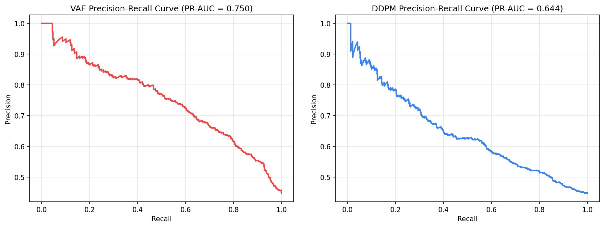
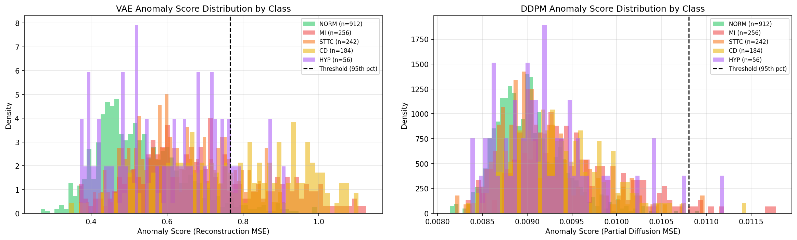

# Generative Models for ECG Anomaly Detection

*Technical report · 26 November 2026*

## Abstract

This project implements a variational autoencoder (VAE), denoising diffusion probabilistic model (DDPM), and Flow Matching (FM) for recording-level electrocardiogram (ECG) anomaly detection, with shared preprocessing and a Streamlit dashboard. Models train on normal recordings. On 1,650 PTB-XL test recordings at 500 Hz, VAE achieves AUROC 0.7794 and PR-AUC 0.7503; DDPM achieves 0.6706 and 0.6438. FM achieves 0.5267 and 0.5208, respectively. Historical MIMIC-IV-ECG results are also reported. Patient separation, MIMIC preprocessing, calibration consistency, and missing uncertainty estimates limit interpretation. The contribution is an integrated research platform and exploratory comparison.

## 1. Objective and Background

The study examines anomaly ranking on PTB-XL, performance after separate training on MIMIC-IV-ECG, and dashboard support for comparing scores and temporal patterns. The task is binary normal-versus-anomaly detection; diagnostic classes define evaluation subgroups.

VAE learns reconstruction with latent regularization [1], DDPM learns noise reversal [2], and FM learns a time-dependent velocity field [3]. This implementation scores reconstruction error for VAE/DDPM and velocity prediction error for FM. It introduces no new generative algorithm. ECG-specific baselines and related work remain necessary before claiming competitiveness.

## 2. Data and Preprocessing

Inputs contain 10 seconds at **500 Hz**: `(batch, 12, 5000)`. Dataset documentation is cited in [4–6]; exact experimental releases and checksums remain unrecorded.

| Dataset | Normal train | Normal validation | Test normal | Test anomaly |
|---|---:|---:|---:|---:|
| PTB-XL | 7,342 | 815 | 912 | 738 |
| MIMIC-IV-ECG | 74,706 | 8,300 | 8,993 | 69,296 |

**Labels.** PTB-XL codes are mapped through `scp_statements.csv`. Only records mapping to one diagnostic superclass are retained: NORM, myocardial infarction (MI), ST/T change (STTC), conduction disturbance (CD), or hypertrophy (HYP). Multiple codes within one superclass are allowed; ambiguous/unmapped records are excluded, without confidence thresholding.

MIMIC NORMAL requires exact report matches `report_0="Sinus rhythm"` and `report_2="Normal ECG"`. Remaining report text is matched in order: atrial fibrillation/flutter → AF; ST elevation/depression → ST; otherwise → OTHER. These machine-report labels lack negation handling and adjudication.

**Splits.** PTB-XL uses fold 10 for testing. MIMIC reserves the last 10% of lexicographically sorted subject IDs for testing. Both shuffle remaining normal records with `random_state=42` and hold out 10% for validation. Record keys do not overlap, but training/validation patient separation is not enforced. Patient counts, waveform duplication, and exclusion totals remain unaudited. Cached splits, including bundled Kaggle files, take precedence.

**Processing.** Offline steps are a fourth-order 0.5–40 Hz Butterworth bandpass with forward/backward filtering, a notch (Q=30; PTB-XL 50 Hz, MIMIC 60 Hz), and per-record, per-lead z-scoring. NaNs become zero; near-constant leads are centered. Failed records are skipped and outputs stored as `float32`. A second normalization fits per-lead statistics on normal training records, using divisor one for standard deviations below `1e-8`.

PTB-XL retains input lead order. MIMIC maps named leads and zero-fills missing channels. **A case mismatch leaves aVR/aVL/aVF zero**, consistent with saved zero-variance statistics; affected experiments require corrected processing and retraining. Record-wise normalization removes amplitude information, and equivalence with dashboard preprocessing remains unverified.

## 3. Models and Scores

| Detail | VAE | DDPM | FM |
|---|---|---|---|
| Channels | 32, 64, 128 | 64, 128, 256, 512 | 64, 128, 256 |
| Downsampling stages | 3 | 3 | 3 |
| Latent/time dimension | Latent 128 | Time 512 | Time 128 |
| Decoder | Transposed convolutions | UNet skips, transposed convolutions | UNet skips, nearest-neighbor upsampling |
| Logged parameters | Unrecorded | 14,574,988 | 4,517,708 |

**VAE:** Encoder kernels `[7,5,3]`, strides `[2,2,2]`, ReLU after the first two convolutions; dense mean/log-variance heads and mirrored decoder with final interpolation. Log variance is clamped to [−4,4]. The loss is mean reconstruction MSE plus β times KL regularization averaged over batch and latent dimensions. β ramps to 1 over the first 20% of epochs. Evaluation decodes the posterior mean and scores lead/time-averaged MSE. Weights depend on configured input length.

**DDPM:** Time-conditioned GroupNorm residual blocks and eight-head bottleneck attention predict Gaussian noise. Current settings use 500 diffusion steps, linear variance `1e-4→0.02`, and unweighted noise-prediction MSE. Training samples indices 1–499. Scoring corrupts at index 19, performs 20 stochastic reverse updates, and measures reconstruction MSE. Bottleneck length is 625. Scoring depth has not been systematically tuned.

**FM:** For independent Gaussian noise z and normal ECG x,

\[
x_t=(1-t)z+tx,\quad t\sim U(0,1),\qquad
L=\mathbb E\|v_\theta(x_t,t)-(x-z)\|^2_{\mathrm{mean}}.
\]

Calibration/evaluation average this velocity error over 50 draws. The dashboard uses 10 draws, requiring alignment. FM has a 256-channel bottleneck and time-conditioned residual blocks. A separate numerical likelihood helper is unused in evaluation; reported FM scores are not exact likelihoods. Generation uses 50 fourth-order Runge–Kutta steps.

**Decisions and maps:** Scores above normal-validation p95 are anomalous; scores are not probabilities. VAE/DDPM maps show lead-averaged squared residuals, although DDPM computes its score and map in separate stochastic calls. FM maps show squared velocity on the input at t=0.5, not a decomposition of its score. Localization is unvalidated.

## 4. Experimental Setup

| Current setting | VAE | DDPM | FM |
|---|---|---|---|
| Optimizer | Adam | Adam | AdamW |
| Learning rate | 0.001 | 0.0002 | 0.0002 |
| Batch size | 64 | 64 | 64 |
| Epoch limit | 50 | 15 | 20 |
| Gradient clipping | Unspecified | 1.0 | 1.0 |
| EMA decay | None | 0.9999 | 0.9999 |

FM weight decay is 0.0001. VAE/DDPM reduce learning rate using validation loss. VAE saves final weights; DDPM saves best and final exponential moving average (EMA) weights; FM's standard weights select the best validation epoch. Resumed sessions with increased epoch limits are continuations, not independent runs.

Training used Kaggle **T4 ×2**. PTB-XL DDPM explicitly uses both GPUs through DataParallel in float32; the FM screenshot shows one active GPU (8.8 GiB), with the second idle. Weekly usage was approximately 30 hours.

| Run | Epochs | Logged training + validation time |
|---|---:|---|
| PTB-XL VAE | 50 | 3 min 47 s total |
| PTB-XL DDPM | 50 | 3 h 12 min total |
| PTB-XL FM | Resumed at 11/20 | 118.5 s/epoch over displayed epochs 11–16 |
| MIMIC VAE | 50 | Unavailable |
| MIMIC DDPM | 15 | Approx. 8 h; timing scope unresolved |
| MIMIC FM | 10 | 3 h 40 min; 4 h 7 min elapsed including startup/loading |

Current settings differ from some completed runs: PTB-XL DDPM trained for 50 epochs at initial learning rate 0.001. Full historical configurations, environment versions, seeds, and checkpoint hashes remain incomplete. Unequal budgets and checkpoint policies limit fairness.

All **500 Hz PTB-XL calibrations** use 815 normal records and percentile 95:

| Checkpoint | Threshold |
|---|---:|
| VAE final | 0.765530 |
| DDPM final EMA | 0.009725 |
| DDPM best EMA | 0.010806 |
| FM best EMA, 50 draws | 1.811988 |

Each threshold must match its checkpoint and scoring settings. Repeated writes to `norm_stats.json` can otherwise mix artifacts.

## 5. Results

AUROC measures ranking across thresholds. PR-AUC is trapezoidal area from scikit-learn's precision–recall curve, not average precision. Anomaly is positive. Test anomaly prevalence is 44.73% for PTB-XL and 88.51% for MIMIC; interpret PR-AUC accordingly.

### PTB-XL, 500 Hz

| Model | Test records | AUROC | PR-AUC |
|---|---:|---:|---:|
| VAE | 1,650 | **0.7794** | **0.7503** |
| DDPM | 1,650 | 0.6706 | 0.6438 |
| FM | 1,650 | 0.5267 | 0.5208 |

| Class versus NORM | Anomaly records | VAE AUROC | DDPM AUROC | FM AUROC |
|---|---:|---:|---:|---:|
| MI | 256 | 0.7883 | 0.7554 | 0.5164 |
| STTC | 242 | 0.7404 | 0.5876 | 0.4449 |
| CD | 184 | 0.8624 | 0.6874 | 0.6617 |
| HYP | 56 | 0.6346 | 0.5859 | 0.4834 |

The observed AUROC ranking is VAE > DDPM > FM. VAE exceeds DDPM by 0.1088 and FM by 0.2527; significance is unknown. FM's overall AUROC is close to the 0.5 chance reference, with below-chance point estimates for STTC and HYP. These results motivate checking training and score behavior, not reversing scores after inspecting test labels. HYP's small sample warrants caution.

DDPM loads **final EMA weights** and scores seven batches in **291 s** (about 176 ms/record amortized). This is aggregate scoring throughput, not single-record latency. Its histogram threshold appears near **0.010806**, matching the best-checkpoint calibration rather than final EMA calibration. The exact threshold used requires verification before interpreting binary decisions; AUROC/PR-AUC do not depend on that threshold.

FM loads `fm_ema_weights.pt` (4,517,708 parameters) and scores 26 batches with 50 CFM draws per signal in **409.6 s** (about 248 ms/record amortized). Its reported p95 threshold, **1.8120**, agrees with the earlier 1.811988 calibration after rounding. DDPM and FM use different batch sizes, so their aggregate timings are not a controlled latency comparison.

### MIMIC-IV-ECG, historical results

| Model | AUROC | PR-AUC | Threshold |
|---|---:|---:|---:|
| VAE | 0.8812 | 0.9833 | 0.360270 |
| DDPM | 0.7325 | 0.9545 | 0.040970 |
| FM | Unavailable | Unavailable | Unavailable |

VAE class AUROCs: AF 0.9915, ST 0.8836, OTHER 0.8639, over 78,289 test records. Class counts are AF 9,079, ST 2,069, OTHER 58,148. DDPM class results are invalid because its per-class branch uses `NORM` instead of `NORMAL`; its binary branch uses the correct dataset label. MIMIC results remain affected by the lead-processing defect.

Separate training and label rules mean that differences across datasets do not establish transfer generalization. Numerical gaps do not establish superiority without uncertainty estimates.

### Evaluation figures

**Figure 1.** PTB-XL 500 Hz precision–recall curves: VAE (left, PR-AUC 0.7503) and DDPM (right, 0.6438). Both use a test cohort with 44.73% anomalies. Panels retain the original axes.

**Figure 2.** Class-wise score densities for VAE (left) and DDPM (right), with p95 threshold markers. Score scales differ by model; class densities are normalized separately. The DDPM threshold/checkpoint pairing requires verification as described above.

The 500 Hz FM evaluation log records figure generation, but those new image files are not yet present locally; the panels above currently show VAE and DDPM only.

## 6. Limitations and Next Steps

| Remaining work | Required evidence or correction |
|---|---|
| Extend evaluation | MIMIC FM evaluation if retaining three-model coverage across both datasets |
| Patient separation | Unique-patient/exclusion counts, source versions, split audit, patient-disjoint validation and affected reruns |
| Processing and calibration | Correct MIMIC leads/class metrics; align FM draws and DDPM checkpoint thresholds; verify dashboard preprocessing |
| Reproducibility | Matched configuration, code/environment/seeds, data/split/checkpoint hashes; VAE parameters and missing timings |
| Statistical evidence | Patient-linked scores, confusion matrices, sensitivity/specificity/precision/F1, paired intervals and multiple training seeds |
| Comparative validity | Comparable budgets/checkpoint rules, ECG baselines, tuning and preprocessing ablations |

Use 2,000 patient bootstrap replicates for 95% percentile intervals and paired differences, recording replicates without both classes. Freeze thresholds before testing. Histograms cannot recover exact predictions or confidence intervals.

Heatmaps require annotated localization evaluation; clinical use requires external validation. Efficiency claims require fixed hardware, batch size, precision, warm-up, GPU synchronization, score draws, and inclusion/exclusion of maps and preprocessing. Sampling-rate and notch-filter benefits remain untested; 100 Hz contains one fifth as many samples as 500 Hz. The dashboard is a research interface, and usability has not been studied.

## 7. Conclusion

The platform integrates three generative ECG detectors and supports exploratory comparison. The completed PTB-XL 500 Hz evaluation ranks VAE, DDPM, then FM by observed AUROC. Corrected MIMIC experiments, patient separation, calibration alignment, and uncertainty estimates are needed for a reliable comparative conclusion.

## References

1. Kingma, D. P., and Welling, M. *Auto-Encoding Variational Bayes*. ICLR, 2014; arXiv preprint, 2013. [Primary paper](https://arxiv.org/abs/1312.6114).
2. Ho, J., Jain, A., and Abbeel, P. *Denoising Diffusion Probabilistic Models*. NeurIPS, 2020. [Primary paper](https://arxiv.org/abs/2006.11239).
3. Lipman, Y., Chen, R. T. Q., Ben-Hamu, H., Nickel, M., and Le, M. *Flow Matching for Generative Modeling*. ICLR, 2023; arXiv preprint, 2022. [Primary paper](https://arxiv.org/abs/2210.02747).
4. Wagner, P., Strodthoff, N., Bousseljot, R.-D., Kreiseler, D., Lunze, F. I., Samek, W., and Schaeffter, T. *PTB-XL, a large publicly available electrocardiography dataset*. Scientific Data 7, 154, 2020. [Dataset paper](https://doi.org/10.1038/s41597-020-0495-6).
5. Wagner, P., Strodthoff, N., Bousseljot, R., Samek, W., and Schaeffter, T. *PTB-XL, a large publicly available electrocardiography dataset*, version 1.0.3. PhysioNet, 2022. [Release documentation](https://physionet.org/content/ptb-xl/1.0.3/). Cited for source documentation; experimental release remains unverified.
6. Gow, B., Pollard, T., Nathanson, L. A., et al. *MIMIC-IV-ECG: Diagnostic Electrocardiogram Matched Subset*, version 1.0. PhysioNet, 2023. DOI: 10.13026/4nqg-sb35. [Release documentation and full author list](https://physionet.org/content/mimic-iv-ecg/1.0/). Experimental release remains unverified.

## Appendix: Supporting Evidence

Training histories and historical PTB-XL results

| Saved history | Epochs | Final train / validation loss | Best displayed epoch |
|---|---:|---:|---|
| PTB-XL VAE | 50 | 0.972250 / 0.806046 | 48: 0.7946; final weights saved |
| PTB-XL DDPM | 50 | 0.016148 / 0.015104 | 46: 0.0146; final EMA also saved |
| MIMIC VAE | 50 | 0.586280 / 0.439806 | Unrecorded here |
| MIMIC DDPM | 15 | 0.014868 / 0.015093 | Unrecorded here |
| MIMIC FM | 10 | 0.131855 / 0.130138 | 9: 0.1294 |

VAE's final reconstruction/KL terms are 0.6647/0.3075 and final learning rate 0.000125. Its loss averages both reconstruction and latent terms over their respective dimensions. Losses differ by model and do not establish convergence from final values alone. The PTB-XL FM standard loss-history file is unavailable.

Epoch timers exclude startup, subsequent checkpoint I/O, and calibration. PTB-XL VAE/DDPM timer sums are 226.8/11,491.8 s. FM's displayed PTB-XL rate extrapolates to 39.5 min for 20 epochs, not a measured total. MIMIC FM epoch timers sum to 13,183.5 s; prefetch takes 1,423.5 s for training and 162.3 s for validation. Arrays occupy 17.9/2.0 GB, not measured peak memory. Final visualization appears at elapsed 14,820.5 s. Session elapsed time and earlier approximate estimates are superseded by these logs where available.

| Historical PTB-XL summary | AUROC | PR-AUC | Threshold |
|---|---:|---:|---:|
| VAE | 0.7523 | 0.8189 | 1.214873 |
| DDPM | 0.7432 | 0.8135 | 0.235634 |
| FM | 0.7144 | 0.7932 | 0.594687 |

These older values remain in local `artifacts/metrics.json`; updated Kaggle evaluations have not been synchronized there. Historical FM class AUROCs are MI 0.6905, STTC 0.6480, CD 0.7574, HYP 0.8741. Their run settings are unresolved; do not combine them with current 500 Hz results. Older figures explicitly carry `100hz` filenames. The inspected local normalization file contains only the VAE threshold, so log-reported calibrations do not establish a complete local artifact bundle. MIMIC summary source: `artifacts/mimic/metrics (4).json`.

Historical MIMIC VAE figures

**Figure A1.** Historical MIMIC VAE precision–recall curve (PR-AUC 0.9833). The precision axis is truncated; anomaly prevalence is 88.51%.

**Figure A2.** MIMIC VAE score densities show greater AF separation from NORMAL than ST/OTHER. Results remain affected by the lead-processing defect. MIMIC DDPM figures also exist, but its class plot has the label defect described above; FM evaluation figures are unavailable.

Implementation and reproduction entry points

Streamlit (`app.py`, `pages/`, `components/`) provides upload/analysis, model comparison, and training diagnostics. `backend/inference.py` resolves local weights or dataset-specific Hugging Face subfolders at `sarav95/ecg-anomaly-weights`. Deployment availability is unverified.

Processing: `scripts/process_{ptbxl,mimic}.py`; models: `backend/models/{vae,ddpm,flow_matching}.py`; labels/splits: `backend/preprocess/`; training/evaluation: `src/train/train_*.py`, `src/eval/eval_*.py`. Configuration/environment: `config.toml`, `pyproject.toml`, `uv.lock`, `requirements.txt`. Architecture documents under `model_architecture/` include older 1,000-sample designs; current source defines implemented models.

Example: `uv run python src/eval/eval_vae.py`. FM threshold calibration is separate; DDPM/FM calibration scripts are under `scripts/compute_*_threshold.py`. Dataset changes require matching paths, processed data, caches, weights, and statistics. Uploads require matching sampling rate, length, lead order, and transforms; fallback constants are not calibrated thresholds. Dependency ranges cannot establish historical environments. Exclude restricted records and patient identifiers from public bundles.

